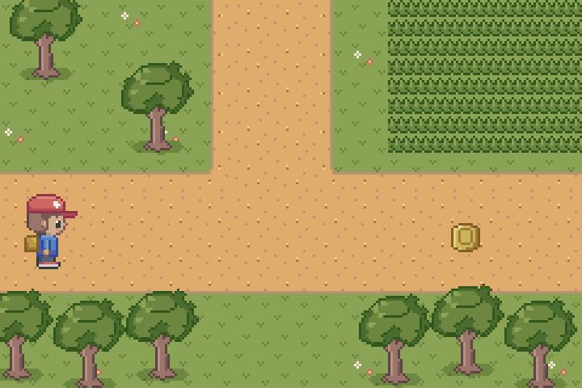
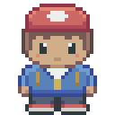
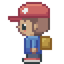
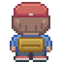
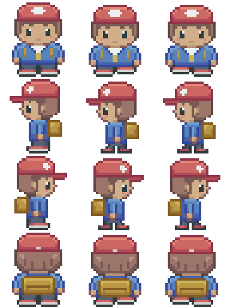
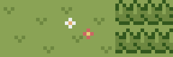
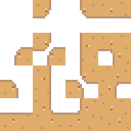
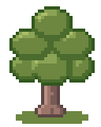

<h1 align="center">pixel-art-mcp</h1>

<p align="center">
  <b>Let Claude draw game-ready pixel art: sprites, walk cycles, effects, seamless tiles and icons.</b><br>
  An <a href="https://modelcontextprotocol.io">MCP</a> server that gives an AI model an Aseprite-style editor: an indexed-color canvas with layers, frames, selections and live previews.
</p>

<p align="center">
  
</p>

<p align="center"><sub>Every sprite and tile above was drawn by Claude through this server. The scene is composed from the exported PNGs and their JSON metadata by <a href="docs/showcase/build-previews.ts"><code>build-previews.ts</code></a>.</sub></p>

---

## Why

Image models paint pictures. Games need **assets**: exact sizes, a fixed palette, frames that line up, tiles that repeat without seams, and metadata an engine can load. pixel-art-mcp lets the model work the way a pixel artist does, one deliberate pixel at a time, and checks its work as it goes:

- 🎨 **Palette-locked.** Every pixel is a palette index, so off-palette colors and blurry anti-aliasing can't happen.
- 👀 **It looks at its work.** Each tool can return an upscaled preview with a pixel grid and rulers, so the model checks what it drew before going on.
- 🧩 **Ready for your game.** You get indexed PNGs plus JSON with frame rects, durations, tags, pivots and tile masks, or a `.aseprite` file to keep editing by hand.

## Showcase

All of these are in [`docs/showcase`](docs/showcase) with their metadata, drawn with the 96-color Otterisk 96 palette.

### A top-down RPG character

A 32×32 hero with a three-frame walk in four directions. The front and back views were drawn as one half and mirrored, the right-facing frames are mirrored from the left, and the body drops a pixel on each step. Outlines take the darkest step of each material's own ramp, and 1-px lines are pixel-perfect.

<table>
  <tr>
    <td align="center"></td>
    <td align="center"></td>
    <td align="center"></td>
    <td align="center"></td>
    <td rowspan="2" align="center"><br><sub><code>hero.png</code>: 3 frames × 4 directions</sub></td>
  </tr>
  <tr>
    <td align="center"><sub>down</sub></td>
    <td align="center"><sub>left</sub></td>
    <td align="center"><sub>right</sub></td>
    <td align="center"><sub>up</sub></td>
  </tr>
</table>

### Animated effects

<table>
  <tr>
    <td align="center"></td>
    <td align="center"></td>
    <td align="center"></td>
  </tr>
  <tr>
    <td align="center"><sub>explosion · 32×32 · 7 frames</sub></td>
    <td align="center"><sub>coin · 16×16 · 6 frames</sub></td>
    <td align="center"><sub>sparkle · 16×16 · 6 frames</sub></td>
  </tr>
</table>


### Seamless tiles and autotiling

Claude drew four path tiles: full, edge, outer corner and inner corner. `generate_autotile` derived the other twelve, and `check_transition_set` confirmed that every edge lines up. Over the grass tiles, that's enough to paint any path shape.

<table>
  <tr>
    <td align="center"></td>
    <td align="center"></td>
    <td align="center"></td>
  </tr>
  <tr>
    <td align="center"><sub>grass · flowers · tall grass</sub></td>
    <td align="center"><sub>path: corner15 transition set</sub></td>
    <td align="center"><sub>tree prop</sub></td>
  </tr>
</table>

## Quick start

You need Node.js 20+ and [Claude Code](https://claude.com/claude-code) (or any MCP client).

```sh
claude mcp add --scope user pixel-art -- npx -y @davidkim9/pixel-art-mcp@latest
```

`npx` downloads the server from npm the first time and runs it from its cache after that, so there's nothing to clone or build. Then run `claude` in your game's folder and ask for something:

> Load the Otterisk 96 palette and draw a 32×32 top-down RPG hero with a 3-frame walk cycle in four directions. Export it as a spritesheet.

> Make a seamless 16×16 grass tile and a dirt path transition set that goes over it. Show me a test map.

> Import `assets/enemies/slime.png` and give it a 4-frame squash-and-stretch idle. Keep the same palette.

Exports go to `./assets` in your project. Change that with `configure_project({ outputDir })`.

<details>
<summary>Other MCP clients (Claude Desktop, Cursor, …)</summary>

Add the server to the client's MCP config:

```json
{
  "mcpServers": {
    "pixel-art": {
      "command": "npx",
      "args": ["-y", "@davidkim9/pixel-art-mcp@latest", "--root", "/path/to/your/game"]
    }
  }
}
```

`--root` sets the project folder. Without it, the server uses the folder the client gives it, falling back to the directory it was started in.

</details>

<details>
<summary>Install from source</summary>

```sh
git clone git@github.com:davidkim9/pixel-art-mcp.git
cd pixel-art-mcp
npm install    # also builds dist/
npm link       # puts a `pixel-art-mcp` command on your PATH
claude mcp add --scope user pixel-art -- pixel-art-mcp
```

Without `npm link`, register `node /path/to/pixel-art-mcp/dist/index.js` instead.

</details>

### Teach it your game's style

Give Claude a style guide as a skill. It then draws every asset at your sizes and pivots, with your palette and shading rules, and follows your export steps. [`example/generic-skill/SKILL.md`](example/generic-skill/SKILL.md) is a template to fill in. It also covers pixel-art fundamentals: pixel-perfect lines (and the few places an L-corner belongs), clean slopes and curves, clusters, selective outlines, and when to dither.

## What it can do

| | |
|---|---|
| 🏃 **Sprites & animation** | Frames, tags, durations, onion skin, animated GIF previews, spritesheets (row, grid or packed) |
| 🧍 **Layered characters** | One layer per body part with pivots, attach points, per-direction draw order, poses and `mirror_rig` |
| 🌱 **Seamless tilesets** | Wrap-around drawing, seam checks, and corner15 / blob47 transition sets with autotile generation |
| ✨ **Effects** | Radial gradients, ordered dithering, ramp shading, outlines, drop shadows and additive glow layers |
| 🗂️ **Icons** | A shared size, safe area, outline and shadow for a whole set, exported as an atlas |
| 🎨 **Palettes** | One enforced palette with named shading ramps; load Lospec `.hex`, GIMP `.gpl`, PNG or Aseprite palettes |
| 🔁 **Round trips** | Import PNG sheets and `.aseprite` files, edit them, and write them back in place |

---

## Reference

### Concepts

| | |
|---|---|
| **Indexed color** | Pixels are palette indices. Index 0 is the only transparency, and there is no partial alpha. Layers marked `blend: "additive"` export to a separate `_glow.png`. |
| **Palettes** | `load_palette` accepts a hex list, Lospec `.hex` or GIMP `.gpl` text, a `.png`/`.aseprite`/`.gpl`/`.hex` file, or `builtin:pico8`. Index 0 is inserted as transparent, so the first color becomes index 1. Ramps go dark → light. |
| **Documents** | `kind` is one of `sprite`, `character`, `tileset`, `effect` or `icon`. Layers are listed bottom → top, and frames carry a duration, tag, pivot and label. |
| **Coordinates** | Integer pixels with the origin at the top-left, y pointing down. Pivots are continuous: `(w/2, h)` is the bottom-center. |
| **Drawing** | `draw_grid` is the main tool. Each row is a string, the legend maps characters to indices, `.` leaves a pixel unchanged and `_` makes it transparent. `read_grid` reads pixels back in the same format, and its output can be fed straight back into `draw_grid`. For organic shapes, `draw_path` strokes straight or curved paths that can taper, `draw_polygon` fills irregular or spline-smoothed blobs, and `spray` scatters dabs or small stamps with a seed, falloff and `within` masking. 1px strokes are pixel-perfect (no doubled L corners), and `pixel_perfect` cleans them out of existing linework. |
| **Feedback** | Every pixel-changing tool accepts `preview: true`. The `render_*` tools return PNG images, and `export_gif` writes an animated GIF for people to review. |
| **Undo** | `undo` reverts the last change to a document, up to 30 steps. A tool that fails partway leaves its document unchanged. |
| **Persistence** | `save_project` / `load_project` use `outputDir/.pixelmcp/project.json`. |
| **File access** | Reads are limited to the project folder, `outputDir`, the configured `importRoots`, and folders the client shares with the session (MCP roots, e.g. added with `/add-dir`). |

<details>
<summary><b>Tools (90)</b></summary>

| Area | Tools |
|---|---|
| Project | `configure_project` `create_document` `list_documents` `get_document_info` `duplicate_document` `delete_document` `resize_canvas` `undo` `save_project` `load_project` |
| Palette | `load_palette` `list_palettes` `get_palette` `render_palette`🖼 `define_ramp` `remap_palette` |
| Layers & frames | `add_layer` `remove_layer` `rename_layer` `reorder_layer` `set_layer_visibility` `duplicate_layer` `set_layer_properties` `add_frame` `remove_frame` `duplicate_frame` `move_frame` `set_frame_duration` `tag_frames` `set_pivot` |
| Drawing | `draw_grid` `read_grid` `set_pixels` `draw_line` `draw_path` `draw_polygon` `draw_rect` `draw_ellipse` `spray` `pixel_perfect` `flood_fill` `replace_color` `clear` `set_symmetry` |
| Selection & transform | `select_rect` `select_by_color` `select_layer_content` `deselect` `move_selection` `copy_selection` `paste` `flip_selection` `rotate_selection_90` `offset_layer` |
| Shading & effects | `auto_outline` `drop_shadow` `shade_with_ramp` `radial_gradient` `dither_region` `find_orphan_pixels` |
| Previews 🖼 | `render_preview` `render_frames` `render_onion` `render_tiled` `render_assembled` `render_in_context` `export_gif` |
| Characters | `define_rig_part` `set_draw_order` `define_pose` `mirror_rig` `render_assembled`🖼 `export_character` |
| Tilesets | `set_wrap_mode` `check_seams`🖼 `create_transition_set` `generate_autotile` `check_transition_set`🖼 `render_terrain_preview`🖼 `export_tileset` |
| Icons | `create_icon_set` `apply_icon_style` `export_icon_atlas` |
| Export & validation | `export_png` `export_spritesheet` `export_aseprite` `validate_document` |
| Import | `inspect_file` `import_png` `import_aseprite` `export_to_source` |

🖼 = returns an image. Each tool's description in the MCP schema explains its parameters, and the server also sends workflow guidance as MCP instructions.

</details>

<details>
<summary><b>Workflows</b></summary>

**Effect (fireball)**: `load_palette` → `define_ramp` (fire: dark → light) → `create_document(kind: "effect")` → block out silhouettes per frame (`draw_ellipse`, `draw_grid`) → `render_frames` → color them with `radial_gradient(onlyOpaque: true, dither: "bayer4")` → refine with `draw_grid` → `render_onion` → `tag_frames` → `export_spritesheet`.

**Tree / plant**: tapered, curved trunk and branches with `draw_path(curve: true, width: 5, widthEnd: 2)` → on a layer above, a dark back mass with `draw_polygon(curve: true, filled: true)` using irregular points → break up its rim with `spray(points: <same outline>, stamp: {rows: [".x.", "xxx"], …}, within: "transparent")` → lighter front clumps as smaller curved polygons, offset toward the light → leaf texture with `spray(stamp: …, within: "opaque")` and a few highlight dabs → `pixel_perfect` on any hand-drawn 1px stems.

**Character**: `create_document(kind: "character", width: 32, height: 32)` creates layers `foot_l foot_r body hand_l hand_r head` and one frame per direction (`down up left right`). Draw each part in place on frames 0 (down), 1 (up) and 3 (right). Then `define_rig_part` sets pivots, parents and attach points, `mirror_rig(right → left)` builds the left view, and `define_pose` (`idle_0`, `walk_0`…) adds poses. Review with `render_assembled(pose: "walk_*")` and finish with `export_character`. Pose offsets follow the parent chain and mirror automatically for mirrored directions, and the server warns when a part stops overlapping its parent.

**Transition tileset (grass over dirt)**: `create_transition_set(tileSize: 16, terrains: {lower: "dirt", upper: "grass"}, overlay: true)` gives 16 frames where **frame index = corner mask** (`TL*1 + TR*2 + BR*4 + BL*8`), plus a faint guide layer. Draw tile 15 (full), an edge (3), an outer corner (1) and an inner corner (7), then run `generate_autotile`. Hand-draw diagonals 5 and 10 if the generated ones look off, then run `check_transition_set` and `render_terrain_preview` (the built-in map covers every corner combination) and `export_tileset`.

**Icons**: `create_icon_set(size: 16, count: 8, names: [...])` → draw inside the safe area → `apply_icon_style(outline: 1, shadow: 2)`. Re-run it after edits; it regenerates its own layers. Finish with `export_icon_atlas`.

**Editing an existing asset**: `inspect_file` → `import_png` / `import_aseprite` (colorMode `exact`) → `read_grid` + `render_preview` → change only the pixels the edit needs → `export_to_source`.

</details>

<details>
<summary><b>Output format</b></summary>

Exports are 8-bit **indexed PNGs**. The palette is embedded and index 0 is transparent through a one-entry `tRNS`. Guide layers and hidden layers are never exported. Sheets and atlases separate frames with `atlasPadding` (default 2) and duplicate each frame's edge pixels `atlasExtrude` pixels (default 1) into that padding. Output is deterministic, so the same inputs give byte-identical files.

| Export | Files |
|---|---|
| `export_png` | `name.png` (one frame) |
| `export_spritesheet` | `name.png` sheet, plus `name_glow.png` when there are additive layers |
| `export_character` | `name.png` atlas of every part × direction, or `name_<part>_<direction>.png` per part (`characterExport: "parts"`) |
| `export_tileset` / `export_icon_atlas` | `name.png` atlas |
| `export_aseprite` | `name.aseprite`: indexed, all layers and frames, tags, palette, frame pivots as a `pivot` slice (no metadata file; validation issues are warnings) |
| Metadata | `name.json` next to the PNG and/or a PNG `tEXt` chunk keyed `pixelmcp` (`metadataMode`) |

```jsonc
{
  "version": 1,
  "name": "fireball",
  "kind": "effect",
  "image": "fireball.png",
  "glow": "fireball_glow.png",
  "size": { "w": 162, "h": 34 },        // image size
  "sourceSize": { "w": 30, "h": 30 },   // canvas size of the document
  "pixelsPerUnit": 16,
  "paletteId": "pico8",
  "layout": { "type": "spritesheet", "layout": "row", "padding": 2, "extrude": 1 },
  "frames": [
    { "name": "fireball_0", "rect": { "x": 2, "y": 2, "w": 30, "h": 30 }, "durationMs": 80, "pivotPx": { "x": 15, "y": 15 } }
  ],
  "tags": [{ "name": "loop", "from": 0, "to": 4, "direction": "forward" }]
}
```

`rect` is in image pixels (origin top-left), and `pivotPx` is relative to the rect. Trimmed frames (packed layout) and character parts add `offsetPx`, the rect's position on the original canvas. Tilesets add each tile's `mask` and a `tileset` block (for blob47, a 256-entry `maskToFrame` table). Characters add `part`/`direction` per frame and a `character` block with parts, parents, attach points, draw orders and poses. Icon atlases add `icons: { name: frameIndex }`.

</details>

<details>
<summary><b>Import</b></summary>

- **`import_png`**: when pixel-art-mcp metadata is present, re-import is **lossless**. Frames, durations, tags, pivots, trims, tile masks, icon names and character rigs all come back, and extruded pixels are discarded. Exporting again produces byte-identical files.
  - Other slicing modes: `"none"`, a grid `{frameWidth, frameHeight, margin?, spacing?, count?}` (source-image pixels), `{asepriteJson}` for Aseprite sheet JSON in hash or array format, and `"auto"`. Auto detects a grid from transparent gutters, and when more than one grid fits it refuses and returns the candidates.
  - Integer upscaling is detected (`scale: "auto"`) and reported.
- **Color modes**:
  - `exact` (default) fails if any color is off-palette. The report lists every such color with its pixel count and sample coordinates, and nothing is imported.
  - `nearest` snaps colors in OKLab and reports each substitution.
  - `extract` builds and registers a new palette.
  - Alpha below `alphaThreshold` (default 128) becomes transparent, and the report counts pixels whose alpha changed. Indexed PNGs whose palette matches the project palette keep their indices exactly.
- **`import_aseprite`**: reads `.aseprite`/`.ase` files, keeping layers (groups as `group/child` names, or `layerGroups: "merge"`), visibility, frames, durations, tags with direction, and slices. A slice pivot becomes the frame pivot, and slices named like rig parts are reported as candidates.
  - Linked cels become copies, and tilemap layers are rendered to pixels.
  - Indexed files keep their palette mapping, with the transparent index remapped to 0.
  - Other blend modes and opacity are flattened with a warning; addition and lighten become `additive`.
- **`export_to_source`**: overwrites PNG sources in place with their original layout, including third-party sheet rects and upscale factor, and regenerates metadata. It refuses if the file changed since import unless `force: true`. For `.aseprite` sources it writes `name.png` + metadata next to the file.

</details>

<details>
<summary><b>Differences from the original spec</b></summary>

- **Metadata only describes the images:** frame rects, pivots, durations, tags and asset-specific data. No engine- or language-specific files are generated.
- **PNG encoding is in-house** (`src/png.ts`). pngjs can't write indexed PNGs or `tEXt` chunks. The decoder handles every color type, bit depth and Adam7 interlacing, and tests cross-check it against pngjs.
- **The Aseprite decoder is in-house** (`src/import/aseprite.ts`), following the official format spec. The `ase-parser` package and its sample file serve as a test oracle.
- **Transition sets have 16 frames** (frame index = mask, frame 0 empty in overlay mode) rather than 15.
- **Character frames are directions** (frame *i* = `rig.directions[i]`).
- **`.aseprite` imports default to `scale: 1`.**
- **Additions:** `undo`, `delete_document`, `set_layer_properties`, `set_pivot`, `deselect`, `export_png` and `export_character`; selection modes (add, subtract, intersect).

</details>

## Development

```sh
npm test            # vitest: unit, integration (in-memory MCP client), stdio smoke test, end-to-end scenario
npm run typecheck
npm run build       # → dist/
npm run dev         # run from source with tsx
npx tsx docs/showcase/build-previews.ts   # rebuild the README images from docs/showcase
```

```
src/
  index.ts, server.ts          stdio entry point and tool registration
  tools/                       MCP tool definitions (zod schemas)
  document.ts raster.ts selection.ts shading.ts palette.ts color.ts
  png.ts gif.ts                codecs
  render/                      previews (compositing, contact sheets, bitmap font)
  export/                      atlas layouts, metadata, file writer
  tileset/ character*.ts icons.ts validate.ts
  import/                      PNG/Aseprite import, slicing, color mapping, export_to_source
test/                          vitest suites
docs/showcase/                 example assets, their editor project, and the README previews
```

## License

[MIT](LICENSE)
